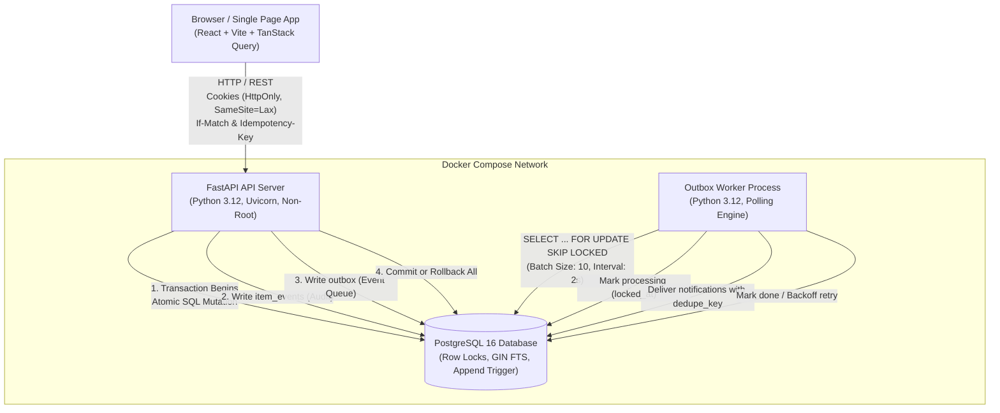

# System Architecture — Newtonite Ops

> **Document Status:** Complete & Verified



---

## Transactional Isolation & Failure Handling

### 1. Atomic Synchronous Path (API Requests)
- Each API request runs inside a single database transaction (`get_db` dependency in FastAPI).
- If the endpoint executes cleanly, the transaction commits.
- If any exception occurs (validation error, constraint violation, authorization failure, or crash), the database session immediately executes `ROLLBACK`.
- **Zero Orphaned Events:** Because `work_items`, `item_events`, and `outbox` records are created in the same transaction, a failure in any step leaves zero residual or half-committed records.

### 2. Transactional Outbox Worker Loop
- The worker runs as an independent daemon container.
- Polls using:
  ```sql
  SELECT id FROM outbox
  WHERE status = 'pending' AND next_attempt_at <= now()
  ORDER BY id
  FOR UPDATE SKIP LOCKED
  LIMIT 10;
  ```
- **Concurrency Safety:** `FOR UPDATE SKIP LOCKED` allows multiple worker instances to run concurrently without stepping on each other or waiting on row locks.
- **Deduplication:** Notifications utilize a composite `dedupe_key = "{outbox_id}:{user_id}"` with a PostgreSQL unique constraint and `ON CONFLICT DO NOTHING`. At-least-once delivery produces exactly-once user notifications.
- **Exponential Backoff:** Failures increment `attempts` and calculate exponential backoff: `[5s, 10s, 20s, 40s, 60s, 900s]` with jitter. After 6 failed attempts, the status is flagged as `failed` for operator inspection.
- **Crash Recovery:** A reaper loop checks for items stuck in `processing` status with `locked_at` older than 60 seconds and resets them back to `pending`.

---

## Network & Boundary Security

1. **Port Isolation:** PostgreSQL port `5432` is not published to the host operating system. Only containers on the internal Docker network can connect to the database.
2. **Non-Root Execution:** All Docker containers execute under dedicated non-root service accounts (`appuser`, `node`).
3. **Defense in Depth Headers:**
   - `Content-Security-Policy`: Disallows untrusted scripts and object frames.
   - `X-Frame-Options: DENY`: Defends against clickjacking.
   - `X-Content-Type-Options: nosniff`: Prevents MIME-sniffing exploits.
   - `Referrer-Policy: strict-origin-when-cross-origin`.
